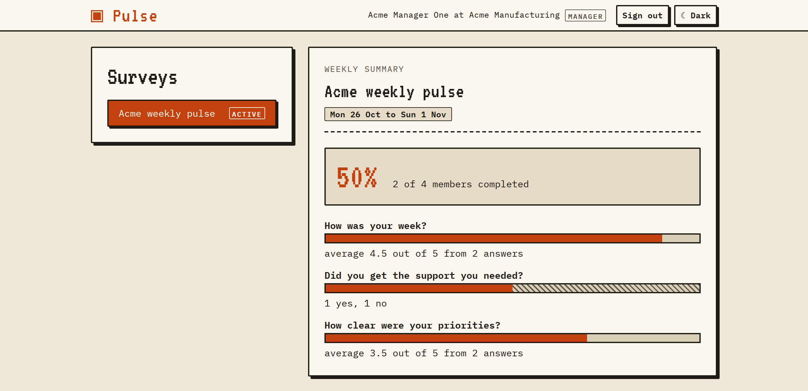
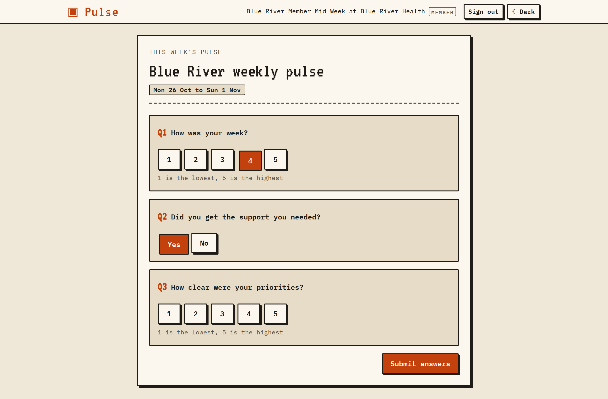
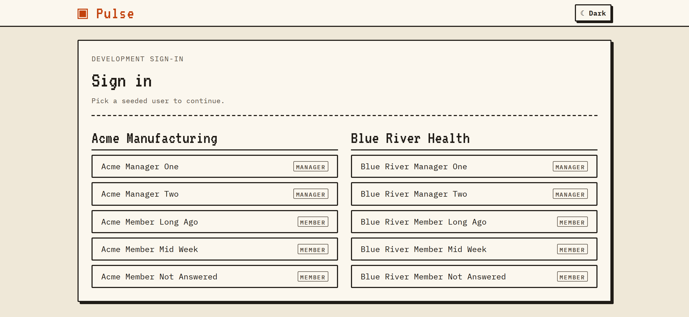

# Pulse Surveys

A small, production-quality slice of a multi-tenant pulse survey SaaS: organisations run short
weekly surveys, people answer them, and managers read a weekly summary.

Stack: TypeScript, NestJS, PostgreSQL and React 19 (19.3.0). The front end is a client-only SPA:
no React Server Components, no server rendering. Everything runs locally, with no external
identity provider and no paid cloud service. Sign-in is a credential-less dev picker: the app
lists the seeded users across both organisations and you become whichever one you pick, kept by a
server-side session cookie. The picker is gated to development
([ADR-0002](okf/adr/0002-dev-sign-in-with-server-side-sessions.md)).

## Screenshots

A Manager reads their organisation's weekly summary:



A Member answers this week's three questions:



The development sign-in picker, listing the seeded users of both organisations:



## Status

The vertical slice is built: the PostgreSQL schema with row-level security, the NestJS API, the
React 19 SPA, and the tests named in the spec (API unit, API e2e, web component and Playwright
journeys). The happy path is three commands:

```bash
npm run db:reset   # start PostgreSQL, create the roles, migrate and seed two organisations
npm run dev:api    # the API on http://127.0.0.1:3000
npm run dev:web    # the SPA on http://127.0.0.1:5173
```

Set `AUTH_MODE=dev` in `.env` to sign in with the seeded picker; see
[Run it locally](#run-it-locally).

- What to build, and in what order: [TODO.md](TODO.md)
- Design, trade-offs, known gaps, the AWS note and the AI workflow: [SOLUTION.md](SOLUTION.md)
- The plan of record, the contracts and the design bundle: [okf/index.md](okf/index.md)

## Prerequisites

- Node.js 20 or newer (developed on 24). NestJS 12 requires 20 or newer.
- npm
- Docker with Compose v2, for PostgreSQL 18.6 ([ADR-0003](okf/adr/0003-local-postgres-with-docker-compose.md))
- git

The Playwright browser is installed on demand; see [Tests](#tests).

## Getting started

```bash
git clone <repository-url>
cd pulse-survey
npm install
git submodule update --init --depth 1
cp .env.example .env
```

`.env` is required: the API, the migrations and the seed read the database URLs from it. The
submodules are read-only reference material, so the `git submodule` command is optional if you only
want to read the docs.

## Run it locally

Two terminals, because both commands are watchers.

```bash
npm run db:reset   # volume, roles, migrations and seed, in one command
npm run dev:api    # NestJS on http://127.0.0.1:3000, every route prefixed with /api
npm run dev:web    # Vite on http://127.0.0.1:5173, proxying /api to the API
```

`AUTH_MODE` defaults to `off`, which makes the two dev routes `404` and leaves no way to sign in.
Set `AUTH_MODE=dev` in `.env` to get the seeded user picker: it lists users from both organisations
and sets an httpOnly session cookie. The API refuses to start with it on unless `NODE_ENV` is
`development` or `test` (`npm run dev:api` sets `development`; unset counts as production). It also
checks the database: migrations never grant the dev sign-in functions to `pulse_app`, `npm run
db:seed` grants them when `AUTH_MODE=dev` and revokes them when it is `off`, and the API refuses to
start when those grants disagree with `AUTH_MODE`. So after changing `AUTH_MODE`, run
`npm run db:seed` again (it is safe to re-run). The seed refuses to run unless `NODE_ENV` is
`development` or `test` (the root script sets `development`) and the database is on this machine.

The seeded responses belong to the week the seed ran in. `npm run db:seed` rewrites them for the
current week, so re-run it (or `npm run db:reset`) before a demo in a later week. See
[ADR-0002](okf/adr/0002-dev-sign-in-with-server-side-sessions.md) and
[ADR-0007](okf/adr/0007-no-production-sign-in.md).

`npm run build` writes `apps/api/dist` and `apps/web/dist` (the API workspace builds
`packages/contracts/dist` first, since Node loads the shared schemas from there). The API serves from `node dist/main`
(`start:prod` in the API workspace); the SPA is client-only static files.

## Database

PostgreSQL runs in Docker Compose (`compose.yaml`), on the official `postgres:18.6` image.

| Script | What it does |
| --- | --- |
| `npm run db:reset` | Delete the local volume, start PostgreSQL, create the roles, migrate and seed two organisations. It deletes local data. |
| `npm run db:up` | Start PostgreSQL and wait until it accepts connections |
| `npm run db:down` | Stop it, keeping the data |
| `npm run db:bootstrap` | Create the two roles and the `pulse` and `pulse_test` databases (idempotent) |
| `npm run db:migrate` | Apply migrations as `pulse_owner` |
| `npm run db:seed` | Seed two organisations, their surveys and responses as `pulse_owner`, and grant the dev sign-in functions to `pulse_app` when `AUTH_MODE=dev` (revoke them when `off`). Local development databases only |
| `npm run db:generate` | Generate a new migration from the Drizzle schema |
| `npm run db:psql` | Open psql inside the container |
| `docker compose down -v` | Stop it and delete the data volume |

The port is published on `127.0.0.1` only. If 5432 is already in use, set `POSTGRES_PORT` in
`.env` and change the port in `DATABASE_URL_OWNER` and `DATABASE_URL_APP` to match. The user,
password and database default to `pulse`; they are local development values, not secrets.

The API connects as `pulse_app`, which owns nothing and is subject to row-level security.
Migrations and the seed run as `pulse_owner`
([ADR-0005](okf/adr/0005-rls-with-a-non-owner-app-role.md)). The two URLs must differ, which the
API asserts on every boot. `drizzle-kit push` is never used, and an applied migration is never
edited.

## Tests

| Command | What it runs |
| --- | --- |
| `npm test` | API unit tests, including the RLS integration suite, plus the web component tests. It brings the database up and runs `db:bootstrap` first. |
| `npm run test:e2e` | API e2e against `pulse_test` as `pulse_app`, prepared by the Vitest global setup |
| `npm run test:e2e:web` | `db:reset`, then the API with `AUTH_MODE=dev` and Vite, then the three Playwright journeys, then a re-seed with the `.env` `AUTH_MODE` |
| `npm run typecheck` | strict `tsc` for both workspaces |
| `npm run lint` | oxlint for both workspaces |

Focused loops: `npm run test -w apps/api` or `npm run test -w apps/web`, and `test:watch` in either.

`npm run test:e2e:web` resets and reseeds the development database, starts the API with
`AUTH_MODE=dev` and the Vite dev server, then runs the three Playwright journeys in
`apps/web/e2e/journeys.spec.ts`: a Manager reads the Acme and Blue River summaries, a Member
submits once and gets a `409` on the second submit in the same week, and a Manager cannot read
another organisation's summary. The run seeds with `AUTH_MODE=dev`, then re-seeds with the
`AUTH_MODE` in `.env` at the end, so `npm run dev:api` still starts afterwards. Screenshots land in `apps/web/e2e/screenshots/` (generated,
gitignored). If Playwright reports that the browser is missing:

```bash
npx playwright install chromium
```

## Documentation

| File | What it holds |
| --- | --- |
| [requirements.md](requirements.md) | The requirements, taken from the original brief |
| [SOLUTION.md](SOLUTION.md) | Design, trade-offs, known gaps, the AWS note and the AI workflow |
| [TODO.md](TODO.md) | The task list, updated every session |
| [AGENTS.md](AGENTS.md) | Instructions and constraints for AI agents working in this repo |
| [okf/index.md](okf/index.md) | The design bundle: overview, design notes and decision records |
| [okf/design/spec.md](okf/design/spec.md) | The plan of record: build order, rules and the definition of done |
| [okf/design/contract.md](okf/design/contract.md) | The frozen tables, endpoints, field names, environment and scripts |
| [okf/design/aws-production-note.md](okf/design/aws-production-note.md) | The AWS design note: deployment, logo storage and serving, and the first tenancy, security and scaling points |

## Design bundle

The design lives in `okf/`, an Open Knowledge Format v0.2 bundle: one concept per markdown file,
linked by bundle-relative paths, with frontmatter that records each concept's `type`, its
`sources`, who generated it and whether a person has verified it.

```bash
npm run okf:validate         # frontmatter, and that every internal link resolves
npm run okf:view             # write okf/viz.html: a concept graph beside a reading pane
npm run okf:mermaid          # check that every Mermaid diagram parses
npm run okf:mermaid:render   # check that every diagram renders, with pan and zoom
npm run react:index          # regenerate the react.dev page index next to the React skill
```

`okf/viz.html` is generated and gitignored. Open it in a browser; its libraries load from a CDN.

The two Mermaid gates need a headless browser. If either complains that one is missing:

```bash
npx puppeteer browsers install chrome-headless-shell   # for the parse gate
npx playwright install chromium                        # for the render gate
```

## Reference source

`references/` holds four read-only, shallow git submodules, pinned by commit: the NestJS and
Drizzle sources, the React library source, and the react.dev documentation site. They exist so
that agents and people can read the exact version in use instead of trusting an older tutorial.
Three local skills map the useful parts of each:

- `.pi/skills/nestjs-reference/SKILL.md`
- `.pi/skills/drizzle-reference/SKILL.md`
- `.pi/skills/react-reference/SKILL.md`, with `docs-index.md` beside it: every react.dev
  documentation page plus the release posts, its canonical URL and its local path

`docs-index.md` is generated. After moving the react.dev submodule to a new commit, regenerate it
with `npm run react:index`. `npm run react:index -- --check` fails if it is stale.

## Repository layout

```
apps/api/       NestJS API, Drizzle schema and migrations, seed and tests
apps/web/       React 19 SPA, component tests and Playwright journeys
packages/contracts/  the API contract as Zod schemas, shared by both apps (ADR-0008)
okf/            design bundle: overview, design notes, decision records
references/     pinned NestJS, Drizzle, React and react.dev source, read-only
workflows/      the pi dynamic workflow scripts
compose.yaml    local PostgreSQL 18.6 in Docker Compose
scripts/        OKF validator, viewer, the Mermaid gates and the react.dev indexer
.pi/skills/     local reference skills for agents
```

## Licence

Unlicensed. Published as a portfolio project; no licence is granted for reuse.
