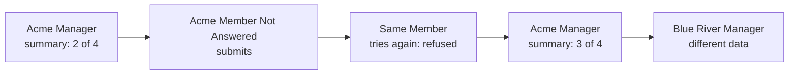
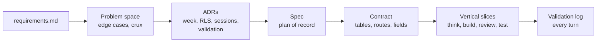
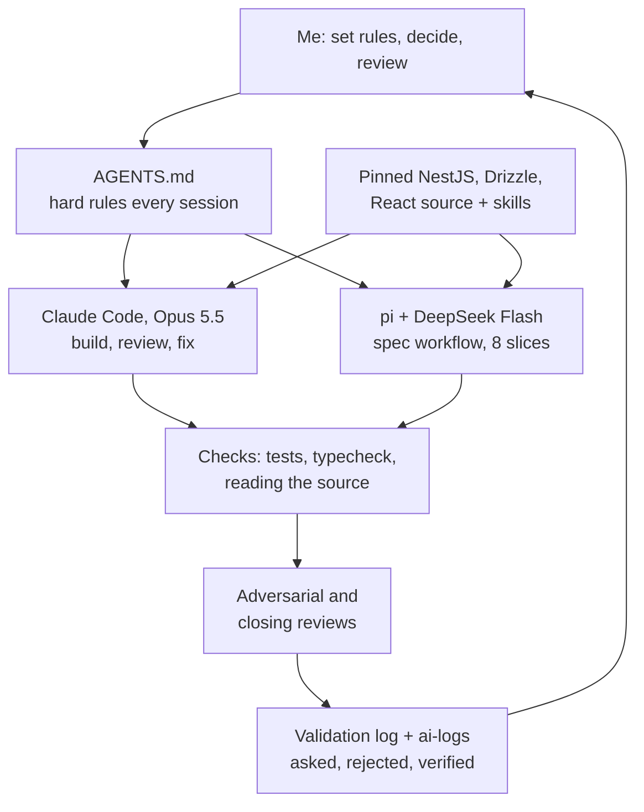
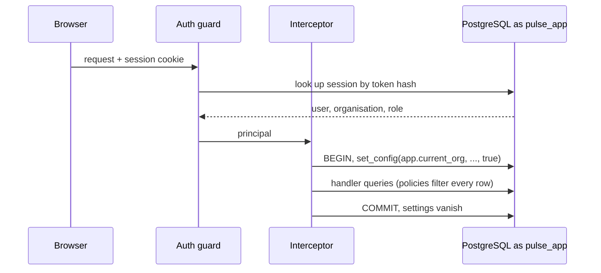
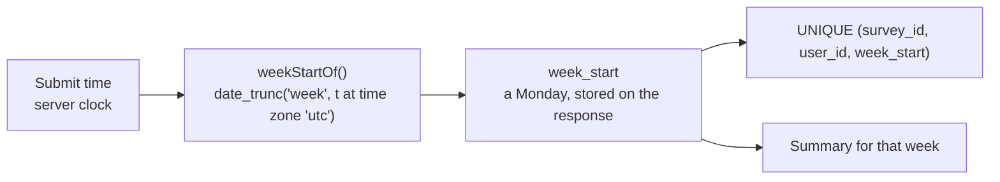

# Demo script

A script for recording a 5 to 10 minute demo. Each section has a time budget, what to show on
screen, and the talking points to cover. The talking points are prompts, not lines to read: say
them in your own words. The full script runs to about 10 minutes. Anything marked _optional_
can be cut, and sections 3 and 7 can each drop to two bullets, to land nearer 6 minutes.

| # | Section | Time | Running total |
| --- | --- | --- | --- |
| 1 | [Introduction](#1-introduction) | 0:45 | 0:45 |
| 2 | [The app, live](#2-the-app-live) | 2:15 | 3:00 |
| 3 | [How it was built](#3-how-it-was-built) | 1:15 | 4:15 |
| 4 | [How AI was used, and checked](#4-how-ai-was-used-and-checked) | 2:00 | 6:15 |
| 5 | [Inside: row-level security](#5-inside-row-level-security) | 1:30 | 7:45 |
| 6 | [Inside: the survey week](#6-inside-the-survey-week) | 1:00 | 8:45 |
| 7 | [Managing complexity](#7-managing-complexity) | 0:45 | 9:30 |
| 8 | [Close: gaps and next steps](#8-close-gaps-and-next-steps) | 0:30 | 10:00 |

## Before you record

Set `AUTH_MODE=dev` in `.env` **first**. The seed grants the picker's database functions only in
dev mode, and the API refuses to start if those grants disagree with `AUTH_MODE`. Then reset, so
the numbers on screen match this script (the seed writes its responses into the current week),
and run the gates once so you can say they pass.

```bash
npm run db:reset                 # fresh database, both organisations seeded for this week
npm run dev:api                  # terminal 1
npm run dev:web                  # terminal 2
npm test && npm run typecheck && npm run lint   # say "green" on camera only if it was
npm run okf:view                 # writes okf/viz.html for section 3
```

Have these open in tabs, in this order:

1. The web app, signed out.
2. `okf/viz.html` (the design bundle viewer).
3. `SOLUTION.md`, scrolled to section 6.6, the validation summary, with section 7 below it.
4. `ai-logs/README.md`.
5. A terminal ready for `npm run db:psql`.
6. `apps/api/src/db/tenant-settings.ts` and `apps/api/src/surveys/week.ts` in the editor.

> [!warning] Order matters in the live demo
> Show the Acme Manager summary **before** the Member submits. The submit changes Acme's
> completion from 2 of 4 to 3 of 4, and the "before" number is the point.

## 1. Introduction

**Show:** the signed-out app.

**Say:**

- This is a small slice of a multi-tenant pulse survey product. Managers publish a short weekly
  survey, Members answer it once a week, and Managers see a summary.
- Two seeded organisations, Acme Manufacturing and Blue River Health, share one database.
- The brief was small on purpose. What makes it hard is three rules: one organisation can never
  see another's data, one response per person per week, and a summary that is honest about who
  was able to answer.
- In ten minutes: the app, how it was built, how I directed and checked the AI, and two
  internals, row-level security and the survey week.

## 2. The app, live



**Do, then say:**

1. **Sign in as _Acme Manager One_.** Point at the dev picker: it lists seeded users, it only
   exists with `AUTH_MODE=dev`, and the API refuses to start with it on in production.
   Migrations never grant the functions it needs; only the dev seed does. Behind it is a real
   server-side session: an opaque token in an httpOnly cookie, hashed at rest, matched to a row.
2. **Open the summary.** Completion is 2 of 4 (50%). Walk the numbers: completion count and
   rate, the rating average with its count, and yes/no counts. The week's dates are shown,
   because "this week" needs to mean something precise. Why 4 eligible? A Member deactivated
   mid-week still counts, one deactivated before the week began does not.
3. **Sign out, sign in as _Acme Member Not Answered_.** Answer the three questions (a rating, a
   yes/no, a rating) and submit. The confirmation names the week.
4. **Reload.** The form is now closed for this week. Say: the UI check is a courtesy, the
   database is the rule. If the UI were bypassed, a unique constraint answers `409`.
5. **Back to _Acme Manager One_.** Completion is now 3 of 4 (75%) and the averages moved.
6. **Sign in as _Blue River Manager One_.** Different surveys, different numbers, no sign of
   Acme. The organisation came from the session row, never from the URL or the body.

## 3. How it was built

**Show:** `okf/viz.html`: the concept graph, then the ADR list.



**Say:**

- Spec before code was a project rule. Nothing in `apps/` was written until the spec and the
  contract were committed.
- The design lives in an OKF bundle: small linked concepts, eight decision records, and a viewer
  with diagrams, quizzes and widgets that run the app's own code.
- The order was: map the problem space, settle the hard decisions as ADRs, write a short spec,
  freeze a contract of table and field names, then build in eight vertical slices (database,
  tenant plumbing, surveys API, responses and summary, the two UIs, browser journeys, docs).
- Then hardening in rounds, each a review followed by fixes: an adversarial review, a patterns
  review against the pinned framework source, and a closing review.
- The stack: NestJS 12, Drizzle, PostgreSQL 18 in Docker, and a client-only React 19 SPA. One
  shared Zod package holds the request and response shapes, so both apps check the same thing.
- Git history is small commits in order, each naming the model that wrote it. Nothing squashed.

## 4. How AI was used, and checked

**Show:** `AGENTS.md` briefly, then `SOLUTION.md` section 6.6 and the log in section 7 below it,
then `ai-logs/README.md`.



**Say:**

- **Division of labour.** Claude Code (Opus 5.5) was the main driver and reviewer. pi ran two
  saved workflows on DeepSeek V4.1 Flash: one wrote the spec (parallel grounders, an architect, a
  reviewer), the other built the eight slices with 47 agents. Cheap models to generate, maximum
  thinking to review, chosen after a three-model eval.
- **What I kept.** Every decision the brief left to me (the week, the isolation approach, the
  sign-in, the validation library), the model routing, when to commit, and the human-reviewed
  stamps on the docs.
- **Grounding, not guessing.** The NestJS, Drizzle and React sources are pinned as read-only
  submodules, with a skill mapping each one. The agent reads the real code, not a tutorial from
  an older version. Early payoff: the pinned Drizzle source showed it sets no tenant variable and
  has no `FORCE ROW LEVEL SECURITY`, which shaped the whole isolation design.
- **Nothing on trust.** Every review finding was reproduced before it was fixed, and every guard
  test was checked by breaking the code and watching it fail. The log has a row per turn: what I
  asked, what I rejected, how I checked. Pick two stories:
  - A draft policy compared a `uuid` column to `current_setting()`, which returns text.
    PostgreSQL has no `uuid = text` operator, so every policy would have failed to create.
  - The worst defect passed the per-slice reviews: any app connection could list every
    organisation's users and create a Manager session. A separate adversarial review found it,
    and now migrations never grant those functions.
- **Honest about the process.** `ai-logs/README.md` lists all 26 sessions (Claude Code and pi)
  with the prompts I typed. The first export kept full transcripts; a review found an API key and
  other project names in it, so before anything was pushed it was replaced with prompts only, and
  the export script now fails if its own scan finds anything sensitive.
- Next time, I would put the "break the tenant boundary" attack inside the workflow rather than
  after it.

## 5. Inside: row-level security

**Show:** `tenant-settings.ts`, then the terminal.



**Say:**

- Isolation is enforced twice. The application scopes every query by organisation, and
  PostgreSQL row-level security catches the query that forgets.
- The API connects as `pulse_app`, a role that owns no table and cannot bypass policies. A
  separate `pulse_owner` runs migrations. That split is why the policies actually apply: a
  table owner skips them.
- Each request runs in one transaction. The organisation, user and role are set with
  `set_config(..., true)`, so they die with the transaction and never leak to the next request
  on a pooled connection.
- Missing settings fail closed. An empty or missing organisation becomes `NULL`, and a policy
  comparing to `NULL` matches nothing. A query that skips the request transaction sees no rows,
  not every row.
- Thirteen policies across six tables, and reading is always separate from writing. Everyone
  in the organisation reads its surveys, but only a Manager can create or change one. A Manager
  reads every response, but anyone, Manager included, can insert only their own. Both splits came
  from late reviews: the old combined policies checked only the organisation, so at database
  level a Member could write a survey and a Manager could answer for someone else. Only the
  routes stopped them. Now the database does too.
- The API refuses to start if its role is a superuser, can bypass RLS, or owns a table.

**Do (_optional_, 45 seconds):** prove it in `psql`.

```sql
-- npm run db:psql
SELECT count(*) FROM surveys;            -- as the admin: every organisation's surveys

SET ROLE pulse_app;
SELECT count(*) FROM surveys;            -- 0: no tenant set, so the policy fails closed

BEGIN;
SELECT set_config('app.current_org', '11111111-1111-4111-8111-111111111111', true);
SELECT title FROM surveys;               -- Acme weekly pulse, and nothing from Blue River
COMMIT;

-- A Manager tries to answer on a Member's behalf
BEGIN;
SELECT set_config('app.current_org',  '11111111-1111-4111-8111-111111111111', true),
       set_config('app.current_user', 'a1000000-0000-4000-8000-000000000001', true),
       set_config('app.current_role', 'manager', true);
INSERT INTO responses (organisation_id, survey_id, user_id, week_start)
VALUES ('11111111-1111-4111-8111-111111111111', 'a2000000-0000-4000-8000-000000000001',
        'a1000000-0000-4000-8000-000000000007', date_trunc('week', now() at time zone 'utc')::date);
-- ERROR: new row violates row-level security policy for table "responses"
ROLLBACK;
```

## 6. Inside: the survey week

**Show:** `week.ts`, then `\d responses` in `psql` to point at the unique constraint.



**Say:**

- "Once a week" sounds trivial and is not. It decides the table, the constraint and the summary
  all at once, so it was the first decision settled.
- A week is an ISO calendar week in UTC, Monday to Sunday. The rejected options were a rolling
  seven days (cannot be stored as a key, so cannot carry a constraint) and weeks anchored to each
  survey (then "this week" means something different per survey).
- One function computes it, on the server. The client never sends a week, and one sent anyway is
  ignored.
- The response stores `week_start`, and a unique constraint on survey, user and week is the rule.
  Two submits at the same instant cannot both win.
- The summary uses the same week to decide who was eligible: Members who had joined before the
  week ended and had not left before it began. That is why the rate can never pass 100%, and a
  test proves it.
- The honest cost: an organisation far from UTC has a few hours at each end of the week outside
  its own calendar week. The UI shows the dates, and a per-organisation timezone is a recorded gap.

## 7. Managing complexity

**Show:** the edge case table in the problem space concept (`okf/design/multi-tenant-problem-space.md`).

**Say:**

- I split the work into **essential** complexity (the week, one response per week, isolation) and
  **incidental** complexity (wiring the stack, the dev sign-in, the UI). Time went to the first.
- Sixteen edge cases, each with a verdict: in scope with a reason, or out with a reason.
- Rules live where they cannot be skipped: the database for uniqueness and isolation, the API edge
  for validation, one pure module for the summary maths with no framework imports, so it is
  simple to test.
- Scope stayed tight: no survey editing, no drafts, no create screen in the UI. Each cut is
  written down, not hidden.
- The costs I accepted are written down too. Row-level security is more machinery than filters
  alone. And the design records took real time from a four-hour brief. I chose that because the
  brief puts weight on how the AI was directed, and the records make that inspectable.

## 8. Close: gaps and next steps

**Say:**

- Known gaps, all recorded in `SOLUTION.md`: no production sign-in (a deliberate decision, the
  session layer is ready for an OIDC provider), no per-organisation timezone, no survey editing.
- Next, in order: a real sign-in, then ship it (container, infrastructure as code, CI running
  every gate from a fresh database), then the timezone. The AWS note covers deployment, logo
  storage and the first scaling and security steps.
- Close on the main point: the AI wrote most of the code, but every decision, rejection and check
  is in the log and the history, so you can see how it was directed.

## If something goes wrong on camera

| Symptom | Likely cause | Fix |
| --- | --- | --- |
| No user picker on the sign-in screen | `AUTH_MODE` is not `dev` | Set `AUTH_MODE=dev` in `.env`, run `npm run db:seed`, restart the API |
| API refuses to start: dev grants disagree with `AUTH_MODE` | `AUTH_MODE` changed after the last seed | `npm run db:seed` (safe to re-run), then restart the API |
| Acme already shows 3 of 4 | A previous run submitted | `npm run db:reset`, then restart the API |
| Acme shows 0 of 4 | Seed ran in an earlier week | `npm run db:seed`: it rewrites the demo responses for the current week |
| Seed refuses to run | Run from the workspace, not the root, or the owner URL is not local | Run `npm run db:seed` from the repository root, against the local Compose database |
| `SET ROLE pulse_app` is refused | Connected as a non-admin role | Use `npm run db:psql`, which connects as the Compose admin |

Deeper reading for questions after the demo: [the guided tour](/pulse-surveys/explainer.md),
[tenant isolation](/pulse-surveys/architecture.md),
[the week decision](/adr/0004-calendar-week-in-utc.md) and
[the problem space](/design/multi-tenant-problem-space.md).
