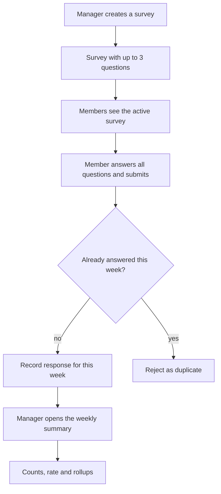

# The problem space: multi-tenant pulse surveys

This note is about the problem, not the solution. It lists the happy path, the edges, and
where the difficulty actually sits, before any schema or route is drawn.

## 1. The happy path

One organisation, called Acme here. The sequence a reader should be able to follow:

1. A Manager signs in by picking a seeded Acme user. Sign-in is a local stand-in, not a real
   identity system, and it is gated to development
   ([ADR-0002](/adr/0002-dev-sign-in-with-server-side-sessions.md)).
2. The Manager creates a survey called "Weekly pulse" with three questions: one rating, one
   yes/no, and one more of either type. At most three is a hard rule.
3. The survey is active immediately. Acme's Members see it when they sign in.
4. A Member answers every question and submits. The server records one response for this
   Member, this survey, this week.
5. The same Member tries again the same week and is told they have already responded. The
   database rejects the duplicate, not only the UI.
6. The Manager opens the summary for the week and sees: completion count, completion rate,
   and per-question rollups (average and count for ratings, counts per option for yes/no).

That is the whole product for this slice. Everything else in this note exists to make that
sequence honest.

## 2. The week boundary is the crux

The phrase "one response per active week" looks small and is not. Three questions hide inside
it:

- What is a week: a calendar week or a rolling 7-day window? The requirements leave this open.
- Whose clock decides the boundary: the client, the server, or the organisation's timezone?
- When is the week fixed: when the form loads, or when the submit arrives?

A response straddling the boundary exposes all three. A Member opens the form on Sunday
23:58 and submits on Monday 00:02. If the client stamps the week, the response lands in the
old week. If the server stamps it, it lands in the new one. The two must not disagree.

The safe answer for this slice: the server computes the week at submit time, from one pure
function that the summary endpoint also uses. The form displays the week it is answering
into, so the Member is not surprised. Both candidate definitions avoid the timezone question
if the boundary is fixed in UTC; the question only returns if the organisation's own local
week is wanted, which needs a timezone column and daylight saving handling.

**Settled on 2026-09-26:** a week is an ISO 8601 calendar week in UTC, Monday 00:00 to Sunday
23:59:59.999, computed by one server-side function, stored on the response as a
`week_start date` and enforced by `UNIQUE (survey_id, user_id, week_start)`. The choice, the
alternatives and the costs are recorded in
[ADR-0004](/adr/0004-calendar-week-in-utc.md). The recommendation in this note was a rolling
window; the calendar week was chosen instead because "this week" is then a phrase the UI can
use literally, and the two cost the same code once the boundary is fixed in UTC.

## 3. Edge cases

The ones below are specific, not a generic checklist. Each says what breaks, how real it is for
a slice this size, and whether the slice handles it. In the `Included` column, a row that is in
the slice carries the reason to include it, and a row that is out carries the reason to leave it
out. The column is the cut, made explicit, so nothing is half-built by accident.

| Edge case | What breaks | Verdict for this slice | Included |
| --- | --- | --- | --- |
| Member answers twice in one week | Two rows for the same Member, survey and week | Real. Must be a database constraint, not a code check | Yes. This is the rule the whole slice exists to prove, and one unique index is the cheapest honest way to enforce it |
| Week boundary crossed mid-response | The response lands in an unexpected week | Real. One server-side week function, used by submit and summary | Yes. It forces the single week function that the constraint and the summary both read, and disagreeing about the week is the failure mode this slice must not have |
| Member joins part way through a week | Do they count in the denominator before they joined? | Real. Decide the denominator rule and state it | Yes. The completion rate is wrong until the denominator rule is decided, so the summary cannot be built without an answer. Settled: the denominator counts members whose membership overlaps the week, so `users` carries `joined_at` and a nullable `deactivated_at` |
| Member leaves part way through a week | Their old responses can outnumber current members | Real. Rate must never exceed 100 percent by accident | Yes. It is the case that breaks a naive member count, so it is the test that proves the denominator rule. Settled: `deactivated_at` after the week's start keeps them in the denominator, so the rate cannot exceed 100 percent |
| Survey edited after responses exist | Old answers stop matching the questions | Real, but defer. Freeze a survey once it has a response | No. The slice has no survey editing after the first response, so freezing is a guard rather than a feature and versioning is deferred |
| Question removed or reworded after responses exist | Orphan answers, or a rating that means something else now | Same as above. No edits after first response in the slice | No. Same reason: with no question editing there are no orphan answers to reconcile |
| Survey with zero responses | Summary must return zeros, not error | Real. Test it | Yes. Every survey starts in this state, and a summary endpoint that errors on an empty week is unusable on day one |
| Rating average when nobody answered | Division by zero | Real. Return null or zero explicitly, never NaN | Yes. One guard on one division, and without it the summary returns NaN, which is a silently wrong number rather than a visible failure |
| Member with no organisation | A query with no tenant to scope by | Mostly noise: the model forbids it, and the auth guard already rejects a user with no organisation | No. A non-null organisation column makes it unrepresentable, so there is no separate path to build and nothing to test beyond the column |
| Role changes mid-week | A Manager becomes a Member, or the reverse | Cheap to handle: check the role at request time, never cache it | Yes. It costs nothing but discipline, and caching the role is the mistake that turns a cheap case into a security bug |
| Survey deactivated or archived | It should stop taking responses but keep its history | Cheap: one status flag, stop inserts, keep reads | Yes. The active survey rule needs a status flag anyway, and stopping inserts while keeping reads is the same flag |
| Organisation and server in different timezones | "This week" means different things | Real, and now that calendar weeks are chosen it is the last few hours at each end of the week | No. UTC keeps the boundary deterministic and DST-free, so the organisation's clock never moves it. Only a Member far from UTC notices, in the hours around the boundary, and the UI shows the week's actual dates. A per-organisation timezone is the fix and is deferred ([ADR-0004](/adr/0004-calendar-week-in-utc.md)) |
| Double-clicked submit | Two POSTs race | Real. The same DB constraint catches the second one; return a friendly 409 | Yes. The unique constraint already catches it, so the only extra work is returning a 409 instead of a 500 |
| Partially completed answers | Half a response exists | Defer. Submit is all-or-nothing; no drafts in the slice | No. With no drafts there is no partial row to store, so submit stays all-or-nothing |
| Manager asks for another organisation's summary | Cross-tenant read | Real and top priority. The organisation always comes from the authenticated user | Yes. Top priority. The organisation comes from the authenticated user, never from the request, and this is the row the isolation test exists for |
| Completion rate when member count changes | Denominator drifts during the week | Real. Count members who were in the org at any point that week | Yes. It is the denominator rule again at the summary boundary, and it must agree with the join and leave rows |

A few more that fall out of the same rules:

- A rating outside 1 to 5 is rejected at the API edge. It is validation, not domain design.
- A blank answer on one question is a partial response. Rejected with the others at submit.
- A survey with one question is legal. The rollups must not assume three.
- Two Managers in one org can both edit the same survey. Last write wins is fine for the
  slice, and worth a note, but not worth an audit log yet.

The opinionated cut: eleven rows are in and five are out, and the `Included` column says which
and why. The first four rows, the zero-response rows, the double submit, the isolation row, the
cheap rows and the denominator row are in, because each one either proves the rule the slice
exists for or costs almost nothing to handle. Per-organisation timezones, survey versioning,
question editing and drafts are real in a full product but are noise for a timeboxed slice, so
they are excluded explicitly rather than half-built. A member with no organisation is excluded
because the schema makes it unrepresentable.

## 4. Where the complexity lies

Separate what is merely work from what is actually hard.

### Incidental complexity (the stack and the timebox)

- NestJS, Drizzle, PostgreSQL and React 19 are chosen, not discovered. Wiring them is time, not
  difficulty.
- The local sign-in stand-in is incidental. It must be simple enough that nobody mistakes it
  for real identity, but solid enough that the organisation always comes from the
  authenticated user. The chosen shape is a seeded user picker behind a dev flag, with an
  opaque session cookie and a row in the database
  ([ADR-0002](/adr/0002-dev-sign-in-with-server-side-sessions.md)). The picker is what makes
  the two organisations visible in the demo, and it is also the one place where the slice
  deliberately exposes data across the tenant line, which is why it does not exist outside
  development.
- Migrations, seed data with two organisations, and the small React UI are mechanical.

### Essential complexity (the domain rules)

- The week boundary. This is the one rule that sounds trivial and is not. It decides the
  data model, the constraint, and the summary.
- One response per active week per survey, enforced in the database. A code check is a
  courtesy; the constraint is the rule.
- Tenant isolation as an invariant across every query, endpoint and UI path. It is easy to
  say and easy to get subtly wrong in one forgotten filter.
- The summary maths. Completion rate needs a denominator rule that survives joins and
  leaves, and every rollup must survive zero responses.

The honest summary: creating surveys, validating three questions, and rolling up ratings and
yes/no counts are easy. The hard parts are all about time (the week), identity (the tenant),
and counting (the denominator and the zero case).

## 5. What to build first, and where the seams go

Build the happy path end to end first: create a survey, answer it once, read the summary.
That slice proves every hard part at once if the seams below are right.

Seams that matter:

- One place derives the organisation from the authenticated user. Nothing else may.
- One pure function computes the week. Submit and summary both call it.
- One database constraint enforces one response per week. The UI disables the button, but
  the constraint is the rule.
- One summary module owns the maths. It is the only code that counts responses or divides.

Build later, when the happy path is honest: survey editing rules, archiving behaviour, a
per-organisation timezone, drafts, and any audit trail. The week and isolation questions this
note leaves open are settled in [ADR-0004](/adr/0004-calendar-week-in-utc.md) and
[ADR-0005](/adr/0005-rls-with-a-non-owner-app-role.md).

What would make this design wrong later:

- Computing the week in the client, or in two different places.
- Letting the organisation id travel in a body or query string.
- Enforcing the one-response rule only in code.
- Allowing question edits to silently reinterpret old answers.
- Using "current member count" as the denominator without deciding what happens when people
  join or leave.

The smallest thing that still proves the hard parts: two organisations, one survey with three
questions in org A, two Members who answer, a summary with numbers, one test that a second
submit in the same week is rejected by the database, one test that org A cannot read org B,
and one test of the summary with zero responses. That is a small slice, and it touches every
part of the problem that actually bites.

## Reading path

- [Overview](/pulse-surveys/overview.md): the rules this note assumes.
- [Tenant isolation](/design/tenant-isolation-options.md): how the isolation rule can be
  enforced once a choice is made.
- [Dev sign-in](/adr/0002-dev-sign-in-with-server-side-sessions.md): where the organisation
  actually comes from at request time.
- [ADR-0004](/adr/0004-calendar-week-in-utc.md): the week boundary this note calls the crux.
- [ADR-0005](/adr/0005-rls-with-a-non-owner-app-role.md): how the isolation rule is enforced.
- [Decision records](/adr/readme.md): every decision recorded so far.
- [Bundle log](/log.md): the running history of this bundle.
