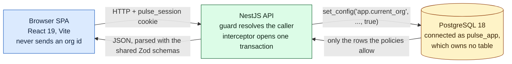
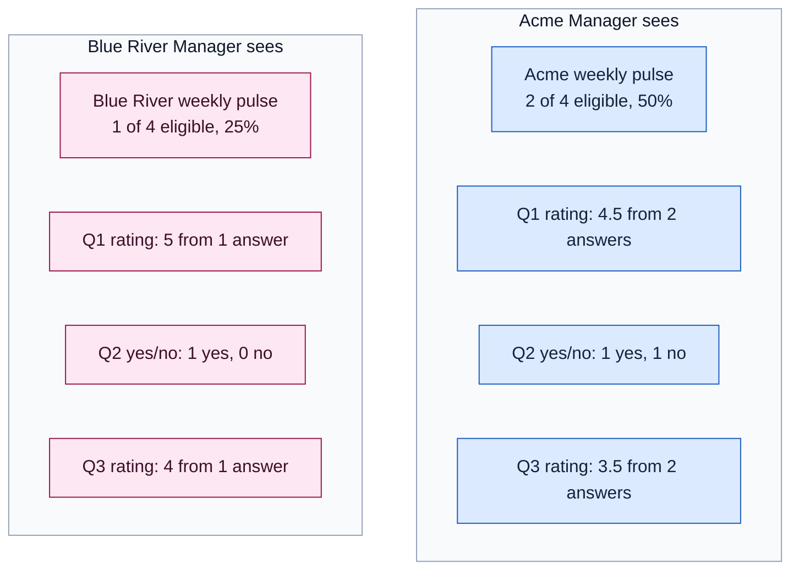
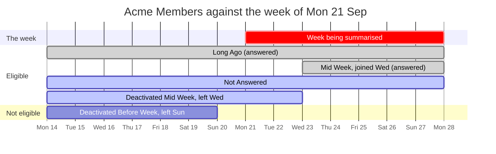
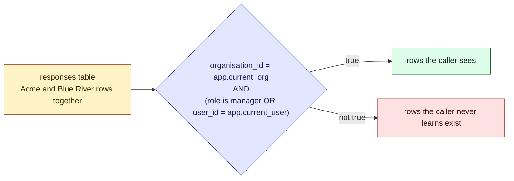
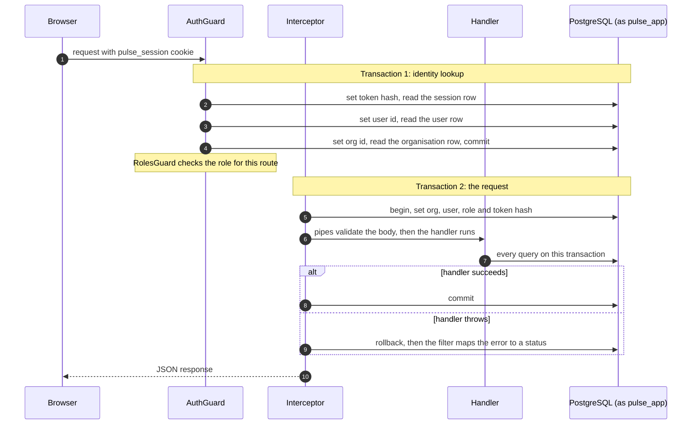
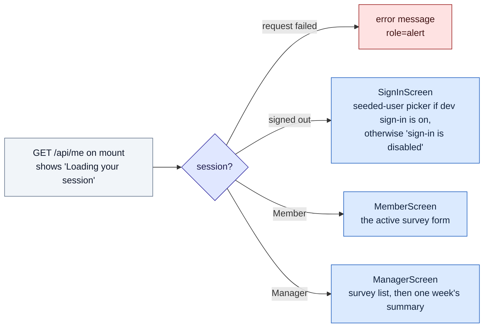

The long-form walk through the slice: what it does, what it is made of, and why one organisation
can never see another's data. The other concepts are the reference; this one is the tour. Read it
top to bottom, or jump to [the thirteen policies](#the-thirteen-policies) if row-level security is what
you came for. Four interactive widgets let you change the inputs and watch the system respond:
who counts as eligible, what the policy on `responses` returns, how responses become a summary,
and where the week begins. A [self-check quiz](#quiz) closes it.

## The problem

### What the app does

A **pulse survey** is a short questionnaire an organisation sends round every week: at most three
questions, each a rating from 1 to 5 or a yes/no, answered in under a minute. Two roles use it:

- A **Manager** creates and manages surveys, and reads the weekly summary.
- A **Member** answers the active survey, once per week.

[Overview](/pulse-surveys/overview.md) states the product rules in full.

### Why isolation is the hard part

The app is **multi-tenant**: one running system holds the data of many organisations at once, and
each must experience it as if it were theirs alone.

> [!definition] Tenant
> One customer of a shared system. Here a tenant is an organisation, and every row of business data
> belongs to exactly one of them.

> [!definition] Isolation
> The guarantee that no query, endpoint or screen can read or write another tenant's data. It is
> not authorisation. Authorisation asks "may this person do this?". Isolation asks "is this data in
> scope for this person at all?".

The danger is one forgotten clause. This query is correct, and it is also a data breach:

```sql
select * from responses where survey_id = $1;
```

It has no tenant filter. Any isolation scheme that lives only in application code is a bet that
nobody ever forgets that `where`. This app does not take the bet: the database itself refuses to
return rows from another organisation, even when the query above runs exactly as written.

### What it is made of

| Piece | Choice |
| --- | --- |
| Language | TypeScript, strict mode, end to end |
| API | NestJS 12: a guard resolves the caller, an interceptor opens the transaction |
| Database | PostgreSQL 18 in Docker Compose |
| Data access | Drizzle ORM and drizzle-kit: schema, constraints and security policies in one file |
| Shared shapes | `packages/contracts`: Zod schemas for every request and response, used by both apps |
| Front end | React 19.3 with Vite, a client-only SPA: no router, no server rendering, no data library |
| Tests | Vitest and supertest for the API, Vitest and Testing Library for the UI, Playwright for the journeys |

The repository is an npm workspace: `apps/api`, `apps/web` and `packages/contracts`.
[Spec](/design/spec.md) is the plan of record and [Contract](/design/contract.md) freezes the
shapes. [Data model](/pulse-surveys/domain-model.md),
[Tenant isolation](/pulse-surveys/architecture.md), [API surface](/pulse-surveys/api.md) and
[Front end](/pulse-surveys/frontend.md) are the reference for each layer.



Two facts in that picture carry the design, and the rest of this page explains them: the browser
never sends an organisation id, and the API connects to the database as a role that owns nothing.

## The idea

### One rule, enforced twice

> [!important] The rule
> The organisation comes from the caller's server-side session. Never from a request body, a query
> string or a route parameter.

The rule is enforced in two independent layers:

1. **Application scoping.** Every repository method takes the organisation as a required argument
   and filters on it. The common case is correct before the database does anything.
2. **Database policies.** PostgreSQL row-level security (RLS) catches the query that forgot. This is
   the layer that makes the guarantee hold, because it does not depend on any one developer being
   careful.

A useful picture:

- The session lookup is the **front desk**. It checks your badge once and works out your name,
  organisation and role. It is the only place identity comes in from outside.
- The policies are **locks on every door**. Each lock reads the organisation off your badge. You
  cannot tell a lock which organisation you belong to.
- The organisation is a **stamp that fades**. It is written onto the database connection for one
  transaction, then wiped.

Why must the stamp fade? The API does not open a fresh database connection for each request. It
keeps a small set of connections and lends them out, one request after another. If the stamp stayed
on a connection, the next request to borrow it might come from a user in a different organisation,
and the locks would treat that user as a member of the first organisation.

The visible consequence: a Manager who pastes a Blue River survey id into a request gets a `404`,
the same response as for a made-up id. A `403` would say "this exists, but it is not yours", which
is itself a small leak.

### A worked example: one week at Acme

The seed holds two organisations, **Acme Manufacturing** and **Blue River Health**, each with two
Managers and five Members, and each with an active survey carrying the same three questions:

1. `How was your week?` (rating 1 to 5)
2. `Did you get the support you needed?` (yes/no)
3. `How clear were your priorities?` (rating 1 to 5)

This week two Acme Members answered (5, yes, 4 and 4, no, 3) and one Blue River Member answered
(5, yes, 4). Each Manager sees only their own organisation's summary:



The same handler, the same SQL and the same summary code ran for both. The only difference was the
organisation stamped on the transaction. If a filter were missing anywhere, one Manager would see
the other's numbers, or a blend of both, which is why this two-organisation demo is the visible
proof of isolation.

### Why "2 of 4" when Acme has five Members

A completion rate needs a fair denominator. Counting everyone who was ever a Member would punish a
Manager for people who left last year, so the denominator counts Members whose **membership
overlapped the week**:



- **Deactivated Before Week** left on the Sunday before. No overlap, so not counted. That is the
  fifth Member.
- **Deactivated Mid Week** left on the Wednesday. They were there on Monday and Tuesday, so they
  count.
- **Mid Week** joined on the Wednesday, and counts.
- **Not Answered** was there all week and did not answer: in the denominator, not the numerator.
  This is the case the rate exists to show.

So the rate is 2 of 4. One more branch keeps it honest: the eligible set is "Members whose
membership overlapped the week, **or anyone who responded that week**". Without the second branch,
a Member who answered and was later promoted to Manager would count in `completed` but not in
`eligible`, and the rate could go above 100%. With it, every respondent is in the denominator, so
the rate can never exceed 1. A test promotes both Acme respondents to Manager and checks exactly that.

Try it below. Move join and leave days, untick answers, and load the promotion scenario to see
the rate go above 100% with the branch off. The rate is the API's own `completionOf`.

```widget
eligibility
```

### Member privacy: one table, two answers

A Member must not read another Member's response either. That is the same idea one level down, and
it lives in the same place: an extra clause on the `responses` policy.

> [!definition] Row-level security policy
> A rule attached to a table that PostgreSQL applies to every query from the roles it names. It
> decides which rows those roles may see or write, and the application cannot opt out of it.



A Manager passes the role test and sees every response in their organisation. A Member passes only
the `user_id` test and sees their own. Same table, same query, two answers, decided by the
database.

## How it works

### One request, two transactions



Why two transactions? In NestJS, **guards run before interceptors**. The guard must know who is
calling before the interceptor can open the request transaction, so the guard does its lookup in
its own short transaction and commits. Both set their settings transaction-locally, so neither can
leak into the other or into the next request. How the request transaction then reaches every
query, without any class holding it, is the subject of the
[Nest tour](/pulse-surveys/nest-explainer.md).

The identity lookup has a fixed order, dictated by the policies. Each step makes the next row
visible:

1. Set the **token hash**. Policy 3 now shows exactly one session row. If it has expired, delete it
   and stop (`401`).
2. Set the **user id** from that session row. The self-read branch of policy 2 now shows the user.
   If the user is deactivated, delete the session and stop (`401`).
3. Set the **organisation id** from that user row. Policy 1 now shows the organisation.

The user and organisation are always **derived from rows a policy let through**, never asserted by
the client. Putting them in the cookie would be simpler, and a tampered cookie would then be a
cross-tenant read with no second opinion. The session design is in
[ADR-0002](/adr/0002-dev-sign-in-with-server-side-sessions.md).

> [!tip] Why check the user row on every request
> A session outlives the moment it was created. Without step 2, a Member deactivated on Sunday could
> keep using their cookie on Monday and submit a response. Reading the user row on each request
> means deactivation takes effect at once.

### The four settings, and the empty-string trap

The interceptor sets four values in one round trip:

```ts
await tx.execute(
  sql`select set_config('app.current_org', ${org}, true),
             set_config('app.current_user', ${user}, true),
             set_config('app.current_role', ${role}, true),
             set_config('app.current_session_token', ${token}, true)`,
);
```

The values are bind parameters, never string-built SQL. The third argument, `true`, makes each
setting **transaction-local**: PostgreSQL drops it when the transaction commits or rolls back. A
request with no session gets a transaction too, with every value set to `''`.

> [!warning] The empty string, not NULL
> After a transaction-local `set_config` ends, the setting reads as the **empty string** on that
> connection, not as `NULL`. Casting `''` to `uuid` raises SQLSTATE 22P02, so a reused pooled
> connection would fail with an error instead of failing closed. This was a real bug in this
> project, caught in review.

The fix is one set of fragments in `tenant-settings.ts`, reused by every policy:

```ts
export const appOrg = sql`nullif(current_setting('app.current_org', true), '')::uuid`;
export const appUser = sql`nullif(current_setting('app.current_user', true), '')::uuid`;
export const appRole = sql`current_setting('app.current_role', true)`;
export const appSessionToken = sql`current_setting('app.current_session_token', true)`;
```

`nullif(..., '')` turns a missing or empty setting into `NULL`. `column = NULL` is never true, so the
policy matches no rows: the caller **sees nothing**, rather than seeing everything or getting an
error. That is fail-closed. The `::uuid` cast is needed because `current_setting` returns `text`
and PostgreSQL has no `uuid = text` operator. The role and token need no `nullif`: they are
compared as text, and `''` matches neither `'manager'` nor a 64-character hash.

### The owner exemption, and the second role

> [!important] A table's owner is exempt from that table's policies
> PostgreSQL does not apply RLS to a table's owner unless the table is set to
> `FORCE ROW LEVEL SECURITY`. If the API connected as the role that owns the tables, every policy
> on this page would be decoration.

`FORCE` was considered and rejected, because the seed and `pg_dump` run as the owner and would then
need their own settings. The answer is two roles:

- **`pulse_owner`** owns the schema and every table. It runs migrations and the seed. The API never
  connects as it.
- **`pulse_app`** is the API's connection: not a superuser, no `BYPASSRLS`, and it owns **no table
  at all**, so the exemption can never apply to it. No `FORCE` needed.

The policies were not made stronger; the one thing that would have made them optional was removed.
The trade-offs are in [ADR-0005](/adr/0005-rls-with-a-non-owner-app-role.md) and the research in
[Tenant isolation: what Drizzle and Nest actually give us](/design/tenant-isolation-options.md).

Mixing up the two connection strings would silently switch the security model off, so the API
guards against it before it listens. It refuses to start if the two URLs are equal, and it asks
the database about its own role: it refuses if that role is a superuser, has `BYPASSRLS`, owns any
table, or can `SET ROLE` to a role that does.

> [!caution] What RLS does not cover
> It does not apply to a superuser or a `BYPASSRLS` role, to `TRUNCATE`, or to foreign key checks.
> The first is why the startup check exists. The last is why the composite foreign keys below
> exist.

### The thirteen policies

Seven tables carry thirteen policies. Every one names `pulse_app` as its target (with no target,
a policy applies to every role).

| # | Table | Policy | Command | Predicate |
| --- | --- | --- | --- | --- |
| 1 | `organisations` | `organisations_select_own` | select | `id = app.current_org` |
| 2 | `users` | `users_select_self_or_org` | select | `id = app.current_user OR (organisation_id = app.current_org AND app.current_role = 'manager')` |
| 3 | `sessions` | `sessions_select_own_token` | select | `token_hash = app.current_session_token` |
| 4 | `sessions` | `sessions_delete_own_token` | delete | `token_hash = app.current_session_token` |
| 5 | `surveys` | `surveys_select_org` | select | `organisation_id = app.current_org` |
| 6 | `surveys` | `surveys_insert_manager` | insert | `organisation_id = app.current_org AND role = manager` |
| 7 | `surveys` | `surveys_update_manager` | update | `organisation_id = app.current_org AND role = manager` (both halves) |
| 8 | `questions` | `questions_select_org` | select | `organisation_id = app.current_org` |
| 9 | `questions` | `questions_insert_manager` | insert | `organisation_id = app.current_org AND role = manager` |
| 10 | `responses` | `responses_select_org` | select | `organisation_id = app.current_org AND (role = manager OR user_id = app.current_user)` |
| 11 | `responses` | `responses_insert_own` | insert | `organisation_id = app.current_org AND user_id = app.current_user` |
| 12 | `answers` | `answers_select_org` | select | `EXISTS (a parent response in this org that the caller may see)` |
| 13 | `answers` | `answers_insert_own` | insert | `EXISTS (a parent response in this org that the caller owns)` |

Four notes:

- **Policy 2 has a self-read branch** because the guard reads the user before it knows the
  organisation. The organisation-wide branch also needs the Manager role, so a Member reads only
  their own row; the Manager's eligible count needs the organisation-wide read.
- **Policies 3 and 4 make `sessions` unlistable.** A row is visible only to a transaction that
  already holds its token hash, so you must present the cookie to reach your own session. The table
  stores the SHA-256 hash of the token, never the token, so a database dump holds no working
  session.
- **Reads and writes have different rules.** `USING` decides which rows a query can match;
  `WITH CHECK` decides which rows a write may produce. Everyone in an organisation reads its
  surveys, but only a Manager writes one (policies 6, 7 and 9), and policy 7 checks both halves, so
  an `UPDATE` cannot move a survey to another organisation. A Manager reads every response in the
  organisation, but nobody, Manager included, can insert one in somebody else's name (policy 11).
- **Policies 12 and 13 are written out.** `answers` has no `organisation_id`; it reaches its
  tenant through its parent response. Each `EXISTS` subquery runs as `pulse_app`, so policy 10
  applies inside it, and each repeats its own rule on the parent response (the organisation and
  role for reading, the organisation and owner for inserting), so both still hold if policy 10 is
  loosened.

[Tenant isolation](/pulse-surveys/architecture.md) is the reference version, with the test plan.

Now break it. The playground below runs a model of policy 10 against the three seeded responses.
Pick a caller, then switch off the defences one at a time: forget the repository filter (the
policy still holds), connect as the owner (it no longer does), or remove `nullif` and call with no
session.

```widget
rls-playground
```

### Constraints: making bad states unrepresentable

Policies decide who sees what. Constraints decide what may exist at all. The habit worth copying:
if a rule matters, ask whether the database can make breaking it impossible.

| Rule | How the database enforces it |
| --- | --- |
| At most three questions per survey | `UNIQUE (survey_id, position)` plus `CHECK (position BETWEEN 1 AND 3)`: there is no fourth position to use |
| One response per Member per survey per week | `UNIQUE (survey_id, user_id, week_start)` |
| One active survey per organisation | A partial unique index: `ON surveys (organisation_id) WHERE status = 'active'` |
| A child row cannot name another organisation's parent | Composite foreign keys, for example `responses (organisation_id, user_id)` references `users (organisation_id, id)` |
| An answer is exactly one kind | `CHECK (num_nonnulls(rating_value, yes_no_value) = 1)` and `rating_value BETWEEN 1 AND 5` |

Two of these deserve a closer look.

**One response per week is the unique index, not the service.** The service reads first to give a
friendly message, but two submits at the same instant could both pass that read. The insert uses
`ON CONFLICT DO NOTHING` on the index, so the second one gets no row back and the service answers
`409`. There is no gap between the read and the insert for a race to slip through.

**The composite foreign keys matter because foreign key checks skip RLS.** Without them, a question
in Acme could point at a Blue River survey, and no policy would object. `users` carries a redundant
`UNIQUE (organisation_id, id)` purely so `responses` can reference the pair. The same pattern pins
`questions` and `responses` to their survey's organisation.

[Data model](/pulse-surveys/domain-model.md) lists every table, constraint and index.

### Grants are verbs, policies are rows

RLS says which rows. SQL grants say which operations, and `pulse_app` gets the fewest that work:

| Table | Grants |
| --- | --- |
| `organisations`, `users` | `SELECT` |
| `sessions` | `SELECT, DELETE` (no `INSERT`: sessions are created by a dev-only function) |
| `surveys` | `SELECT, INSERT, UPDATE` (a Manager archives and reactivates) |
| `questions`, `responses`, `answers` | `SELECT, INSERT` |

There is no `UPDATE` or `DELETE` on `responses` or `answers`. A submitted response cannot change,
not because a service declines to, but because the role has no verb for it.

### The dev sign-in: the one deliberate exception

Without an identity provider (the brief rules one out), the demo needs a way to sign in as a seeded
user from either organisation. That picker is the one deliberate cross-tenant read in the system,
and it is fenced off:

- It is served by two `SECURITY DEFINER` functions in a separate `dev` schema. They run as
  `pulse_owner`, with `search_path` pinned so a caller cannot shadow the tables they read. The
  `users` table itself stays org-scoped.
- The flag defaults to off, and `AUTH_MODE=dev` is refused unless `NODE_ENV` is `development` or
  `test`. An unset `NODE_ENV` counts as production.
- With the flag off, the guard answers `404` on dev routes before the body is even validated, so
  they look like routes that do not exist.
- A migration revokes access to the dev functions everywhere. Only the seed CLI and the test setup
  grant it back, and the API refuses to start if the grants and `AUTH_MODE` disagree in either
  direction.

[ADR-0007](/adr/0007-no-production-sign-in.md) records why there is no production sign-in at all.

### The summary maths, and why null is not zero

All the counting and dividing lives in `summary.math.ts`, and a test walks the source tree to prove
no other API file divides. The repository runs the SQL; the maths module does the arithmetic, so
the edge cases are testable without a database.

```ts
export function completionOf(completed: number, eligible: number): Completion {
  return {
    completed,
    eligible,
    rate: eligible === 0 ? null : completed / eligible,
  };
}
```

- **The rate is a fraction**, never a percentage and never clamped. The client formats it with
  `Intl.NumberFormat` and never divides.
- **Zero eligible is `null`**, not `0` and not `NaN`. A new organisation has not failed to complete
  anything; it has no denominator yet. The client shows "no eligible members".
- **A rating average arrives as a string**, because PostgreSQL returns `avg()` as `numeric`, which
  the driver hands over as text. The maths module converts it; anything non-numeric becomes `null`
  while the count is kept. The client shows a `null` average as "no answers yet".
- **The week** is `date_trunc('week', now() at time zone 'utc')`: a Monday-to-Sunday week on the UTC
  clock, computed in one SQL fragment and never taken from the request body
  ([ADR-0004](/adr/0004-calendar-week-in-utc.md)).

The sandbox below walks the whole path with the real code at each step: the raw rows PostgreSQL
would return, the API's `completionOf`, `ratingOf` and `yesNoOf`, the shared `summarySchema`, and
the web app's own `SummaryPanel`. Remove every response, or set eligible to zero, and watch `null`
reach the screen as words rather than as `0`.

```widget
summary-stats
```

And the week itself. Pick a wall clock and a preset: a Member in Johannesburg who answers at
00:30 on Monday is still answering last week, because the server truncates on the UTC clock.

```widget
week-bounds
```

[API surface](/pulse-surveys/api.md) is the reference for the summary payload.

### The client

The front end is a client-only React SPA. `App` derives exactly one of five states in render, from
the session alone:



There is no router, so no screen has a URL, so there is no URL that could carry an organisation
id. Signing in or out replaces the session, and the same derivation picks the next screen, so
switching organisation is always a sign-out and a sign-in. The habits worth naming:

- **One Context.** `SessionProvider` owns the single `GET /api/me` and exposes `signIn`, `signOut`
  and the bootstrap state. A sign-in or sign-out answer replaces the fetched session, so there is
  never a second call. The session is display state only: the API derives the caller from the
  cookie on every request.
- **One hook owns loading.** `useApiResult(key, call)` returns `idle`, `loading`, `ready` or
  `failed`. Loading is derived in render by comparing the key with the key of the last settled
  result, so a stale response never shows under a newer key.
- **One module calls `fetch`.** `api/client.ts` returns an `ApiResult` value and never throws: a
  network failure, a non-OK status and a parse failure are all values that render inline. Only a
  real programming error reaches the `ErrorBoundary`.
- **Responses are parsed with the server's own schemas.** `api/parsers.ts` runs each payload
  through the Zod schema from `@pulse/contracts` that the API validates with, so a renamed field
  fails the type check on both sides ([ADR-0008](/adr/0008-shared-contracts-package.md)).
- **The form is a React 19 Action.** The Member screen is `<form action={submitAction}>` with
  `useActionState`. The action returns an outcome instead of throwing:

| Outcome | What the Member sees |
| --- | --- |
| `submitted` | "Answers recorded for Mon 21 Sep to Sun 27 Sep." (the label comes from the server) |
| `duplicate` (`409`) | "You have already answered this week." |
| `invalid` (`400`) | the API's message |
| `error` | a retry message |

The form disables itself after a `submitted` or `duplicate` outcome, but that is a courtesy. The
unique index is the authority, and the `409` is what proves it.

Styling is one hand-written stylesheet layer with retro tokens (`VT323` headings, `IBM Plex Mono`
body, square corners, hard shadows) and a light and dark theme set before first paint. Each
question is a `fieldset` with real radio inputs, the submit result is an `aria-live` region, and
errors use `role="alert"`. [Front end](/pulse-surveys/frontend.md) is the reference.

### The tests that make the claims real

- **Unit tests** for the pure pieces: the summary maths, the week boundaries (Monday 00:00, Sunday
  23:59:59.999, month and year ends) and the response parsers.
- **API end-to-end tests** through a real session against a real PostgreSQL. The isolation suite
  signs in as an Acme Manager and a Blue River Manager and checks that each sees only its own
  surveys, that a cross-tenant `PATCH` is a `404` and leaves the row unchanged, and that the
  summary numbers differ per organisation.
- **A direct RLS suite** that connects as `pulse_app`, sets the settings by hand and queries with no
  HTTP at all.
- **Playwright journeys** through the real UI: a Manager reads both organisations' summaries in
  turn, a Member's second submit is a duplicate, and a Manager cannot read the other organisation's
  summary.

> [!warning] A test that connects as the owner proves nothing
> The owner is exempt from the policies, so an RLS test run as `pulse_owner` passes whatever the
> policies say. The RLS suite connects as `pulse_app` for that reason. As a check, the
> survey read policy (then called `surveys_org_isolation`) was dropped by hand: the suite failed exactly the two cases that
> expect each Manager to see their own surveys, and nothing else.

### What was deliberately not built

- **No production sign-in.** A recorded decision, not a gap: no OIDC, passwords or magic links, and
  the dev picker cannot stand in for one because the app will not start with it outside
  development or test.
- **No create-survey screen.** A tested Manager-only `POST /api/surveys` plus seeded surveys, which
  the brief allows.
- **No `drizzle-kit push`.** It can switch off RLS it does not know about, so migrations are
  applied with `migrate` only.
- **No deployment code.** [Production readiness on AWS](/design/aws-production-note.md) describes
  what would change, and in what order.

## Quiz

Seven questions on the ideas above. Pick an answer and the viewer tells you why it is right or
wrong.

```quiz
An Acme Manager sends GET /api/surveys/<a Blue River survey id>/summary. What comes back?
- [ ] 403 Forbidden, because the role check fails
~ The caller is a Manager, so the role check passes. The problem is not permission, it is visibility.
- [x] 404 Not Found, the same as for a made-up id
~ The row is filtered out by the repository and hidden by the policy, so the lookup finds nothing. A 403 would confirm the id exists.
- [ ] 200 with an empty summary
~ The service looks the survey up first. Finding nothing, it stops with a 404 rather than summarising a survey it cannot see.
- [ ] 500, because the policy raises an error
~ A policy never raises on a read. Rows it does not match are simply left out.
---
Why does the third argument of set_config('app.current_org', $1, true) matter?
- [ ] It marks the setting read-only
~ There is no read-only flag. The third argument is is_local.
- [ ] It validates the value as a uuid
~ set_config stores text. The ::uuid cast happens in the policy fragment.
- [x] It scopes the setting to the transaction, so it cannot survive onto the next request that borrows the pooled connection
~ Connections are shared between requests. A setting that outlived its transaction would stamp one request's organisation on the next. That is why every request runs in exactly one transaction.
- [ ] It shares the setting with other database sessions
~ Settings are never shared between sessions. true narrows the scope further, to one transaction.
---
The API connects as pulse_app, which owns no table. Why does that matter?
- [ ] It makes queries faster, because the owner has more to check
~ Speed is not the point. Ownership decides whether the policies apply at all.
- [x] PostgreSQL exempts a table's owner from its policies, so only a non-owner role is bound by them without FORCE
~ If the API connected as pulse_owner, every policy would be skipped. The startup check refuses a role that owns a table, is a superuser, has BYPASSRLS, or can SET ROLE to one that does.
- [ ] Only a non-owner can use set_config
~ Any role can call set_config. The difference is whether the policies that read the setting apply to it.
- [ ] The owner cannot read tables in the public schema
~ The owner can read everything, and that is exactly the problem.
---
Acme has five Members, but the summary says four are eligible. Why?
- [ ] Only Members who answered count in the denominator
~ Then it would be 2, not 4. The Member who did not answer is in the denominator; that is the case the rate exists to show.
- [ ] Members who joined mid-week are left out
~ Mid Week joined on the Wednesday and does count. Any overlap with the week counts.
- [x] One Member was deactivated before the week began, so their membership does not overlap it
~ Eligible means membership overlapping the week, or anyone who responded that week. The Member deactivated on the Wednesday still counts, because they were there on Monday and Tuesday.
- [ ] Managers are subtracted from the Member count
~ Managers are never in the Member count to begin with. The five are all Members.
---
A Member presses submit twice in the same instant. What guarantees only one response is stored?
- [ ] The service reads hasResponded before inserting
~ That read gives a friendly message, but both concurrent submits could pass it before either inserts.
- [ ] The RLS policy on responses
~ The policy stops a Member writing a row in somebody else's name. A second row in their own name is allowed by it.
- [x] The unique index on (survey_id, user_id, week_start), with ON CONFLICT DO NOTHING
~ Both inserts reach the index. One wins, the other gets no row back and becomes a 409. The rule is a property of the database, not of one code path.
- [ ] The form disables itself after the first submit
~ That is a courtesy for this visit only. Two tabs, or a direct API call, bypass it.
---
An RLS test connects to the database as pulse_owner, and every case passes. What does that prove about the policies?
- [ ] That they are correct
~ The owner is exempt from the policies, so they were never applied.
- [x] Nothing, because the owner is exempt and the test would pass whatever the policies said
~ This is why the RLS suite connects as pulse_app. Dropping a policy by hand then makes it fail, which is how a real isolation test behaves.
- [ ] That FORCE ROW LEVEL SECURITY is on
~ Nothing in this schema sets FORCE, and a passing test would not show it either way.
- [ ] That pulse_app has the right grants
~ The test never used pulse_app, so its grants and its policies were never exercised.
---
A brand new organisation has no eligible Members yet. What does the Manager's summary show for the completion rate?
- [ ] 0%, because nobody completed anything
~ 0% would claim a failure. With no denominator, there is nothing to have failed.
- [ ] NaN%, from dividing zero by zero
~ completionOf checks for zero first and never divides by it.
- [x] "no eligible members", because the server sends a null rate
~ The server sends a fraction or null, and the client only formats it. A null rating average shows as "no answers yet" in the same way.
- [ ] 100%, because the rate is clamped
~ The rate is never clamped. A value above 1 would be a bug in the denominator, and hiding it would hide the bug.
```
