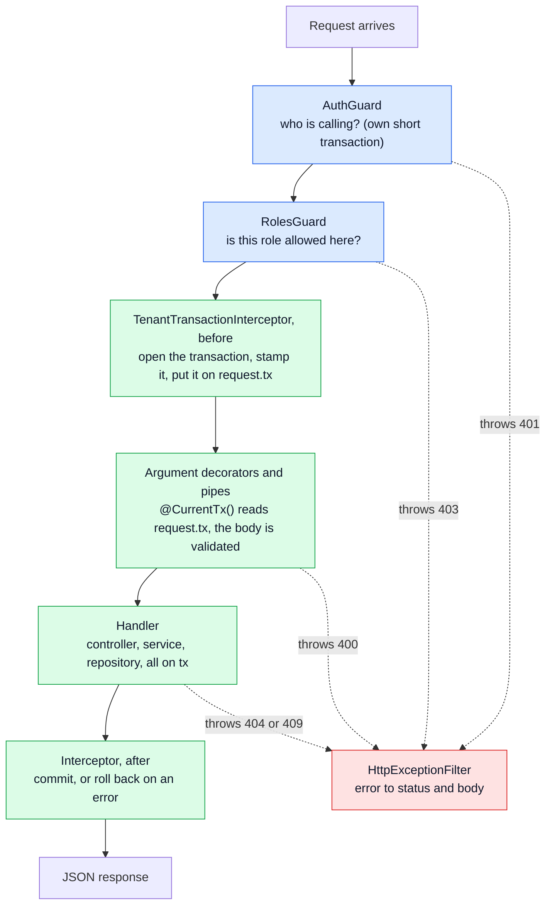

The second tour. [The first one](/pulse-surveys/explainer.md) explains why one organisation can
never see another's data. This one zooms in on the NestJS side: what guards, interceptors and pipes
are, the order they run in, and the question that order raises. **The transaction opens after the
guard, for one request. How does the rest of the code get hold of it?** A widget lets you compare
three answers by memory use and by what they do to the connection pool. A
[short quiz](#quiz) closes it.

## The problem

### Many classes, one request at a time each

Nest builds each class (controller, service, repository, guard) **once, at startup**, and every
request shares that one object. That is cheap and fast, but it means a class cannot keep anything
that belongs to one request in a field. Two requests run at the same time, and a field has room
for only one of them.

The request transaction is exactly that kind of thing. Each request gets its own, with its own
organisation stamped on it, and every query the request makes must run on it. So something has to
carry it from the place it opens to the repository, without putting it anywhere two requests could
share.

## The idea

### The request object carries it

Nest makes one new object per request that every step can see: the request itself. This app uses
it as a tray that moves down the line.

- The **guard** (the front desk from the first tour) checks the badge and puts the caller on the
  tray: `request.principal`.
- The **interceptor** opens the transaction, stamps the organisation on it, and puts it on the
  tray: `request.tx`.
- The **handler** takes both off the tray with `@CurrentUser()`, `@CurrentOrg()` and
  `@CurrentTx()`, then **hands the transaction down by hand**, as an argument, to the service and
  the repository.

Nothing stores the transaction. No field, no global, no cache. When the request ends, the request
object and its transaction are dropped together.

## How it works

### The pipeline, in order



The green boxes run inside the request transaction. All five pieces are registered once, in
`app.module.ts`, as `APP_GUARD`, `APP_INTERCEPTOR`, `APP_PIPE` and `APP_FILTER` providers, so every
route gets the same pipeline and the e2e tests run it too. The order is Nest's, not ours: in
`references/nest/packages/core/router/router-execution-context.ts` the guards are awaited first,
then the interceptors are called with a function that applies the pipes and then calls the
handler.

| Piece | Its job | Answers with | In this app |
| --- | --- | --- | --- |
| Guard | Decide if the request may go on | `true`, or throw | `AuthGuard` finds the session; `RolesGuard` checks `@Roles()` |
| Interceptor | Wrap the handler: run code before and after it | An `Observable` of the result | Opens, commits or rolls back the request transaction |
| Pipe | Check or convert one argument | The value, or throw | Validates the body, query and route id against the shared Zod schemas |
| Filter | Turn a thrown error into a response | The HTTP response | Maps errors to the status and body in the contract |

### Guards say yes or no

A guard has one method, `canActivate`. `AuthGuard` reads the `pulse_session` cookie, looks the
session up, and writes the result to `request.principal`. If the route is not `@Public()` and there
is no session, it throws `401`. `RolesGuard` then reads the roles the route allows and throws `403`
for the wrong one.

Guards run **before** any interceptor, so the request transaction does not exist yet. That is why
the session lookup opens its own short transaction and commits it before the guard returns.

### The interceptor wraps the handler

An interceptor gets the request and a `next` handle it can call to run the rest of the line. Code
before `next.handle()` runs first; whatever comes back runs after. Ours puts the whole handler
inside a database transaction:

```ts
return defer(() =>
  from(
    this.db.transaction(async (tx) => {
      await tx.execute(sql`select set_config('app.current_org', ${org}, true), ...`);
      request.tx = tx;
      return firstValueFrom(next.handle());
    }),
  ),
);
```

Three details matter:

- **`defer`** waits until Nest subscribes before opening the transaction, so nothing starts early.
- **`firstValueFrom`** waits for the handler to finish. Without it the callback would return at
  once, Drizzle would commit, and the handler's queries would run after the commit.
- If the handler throws, the promise rejects, Drizzle **rolls back**, and the error goes on to the
  filter.

### Pipes check each argument

Pipes run inside the interceptor, just before the handler. The argument decorators run at the
same moment, which is why `@CurrentTx()` finds `request.tx` already set. The body is validated by
`StandardSchemaValidationPipe` against the schema named on `@Body({ schema })`, the same Zod schema
the web app uses. A bad body throws `400`, which rolls back a transaction that has not written
anything yet.

### Filters shape the error

`HttpExceptionFilter` catches anything thrown along the line and writes the status and body the
contract promises. A `404` for another organisation's survey looks exactly like a `404` for a
made-up id.

### How the transaction is shared

Follow it from the tray to the database:

```ts
// decorators.ts: read it off the request
export const CurrentTx = createParamDecorator((_data, context) => {
  const request = context.switchToHttp().getRequest<AuthedRequest>();
  if (request.tx === undefined) throw new InternalServerErrorException(...);
  return request.tx;
});

// surveys.controller.ts: take it as an argument, pass it on
async list(@CurrentOrg() organisation: Organisation, @CurrentTx() tx: TenantTx) {
  return this.surveys.list(tx, organisation);
}
```

The service passes `tx` to the repository in the same way, and every repository method takes
`tx: TenantTx` as its first argument. `TenantTx` is a different type from `Db`, the pool handle,
so a query that tries to run outside the request transaction **does not compile**. The transaction
lives exactly as long as the request, because the only things that point to it are the request
object and the function calls that are running for it.

> [!tip] One connection per request, never two
> The guard's lookup commits and gives its connection back before the interceptor borrows one.
> So a request never holds two connections at once. If it did, ten requests could each hold one
> of the pool's ten connections while waiting for a second, and all of them would wait forever.

### Why not inject it instead?

Passing `tx` by hand looks old-fashioned next to dependency injection. There are two other ways,
and the widget below compares all three.

- **A request-scoped provider.** Mark a provider `Scope.REQUEST` and Nest builds a new one for
  each request. The catch is that this **spreads upwards**: anything that depends on it becomes
  request-scoped too (`isDependencyTreeStatic` in
  `references/nest/packages/core/injector/instance-wrapper.ts`). Inject it into the repository and
  the repository, both services and the controller are all rebuilt for every request. There is a
  second catch: Nest builds those instances before the guards run (`loadPerContext` in
  `router-explorer.ts`), so the provider cannot simply return `request.tx`, which does not exist
  yet. It has to be an empty holder that the interceptor fills later.
- **`AsyncLocalStorage`.** Node can carry a value through every `await` in a call chain. The
  interceptor would run the handler inside `als.run({ tx }, ...)` and the repository would read
  the store. It costs little memory, but the link is invisible: forget it, or read it from code
  that runs outside the request, and you get `undefined` at runtime, not an error at compile time.

```widget
request-memory
```

What to notice:

- With the argument, the number of Nest instances **stays at four** however many requests are in
  flight. With request scope it grows by five for every request, including the ones still waiting
  for a connection.
- The pool looks the **same in all three**. Each request holds one connection for as long as its
  transaction is open. The strategies differ only in what else they build.
- Tick `is_local = false` and the idle connections keep the last caller's organisation. That is
  the stamp that does not fade, from the first tour.

## Quiz

Four questions on this page.

```quiz
The auth guard needs the database, but the request transaction does not exist yet when it runs. Why?
- [ ] The guard runs on a different connection pool
~ There is one pool, for pulse_app. The guard borrows from it like everything else.
- [x] Nest runs guards before interceptors, and the interceptor is what opens the request transaction
~ So the guard opens its own short transaction for the session lookup and commits it before returning.
- [ ] Guards are not allowed to use the database
~ They may use anything they inject. This one injects SessionsService, which uses the pool.
- [ ] The transaction opens only after the body is validated
~ The pipes run inside the transaction. It is the interceptor, not the pipes, that opens it.
---
How does SurveysRepository get the request transaction?
- [ ] It reads it from a field set by the interceptor
~ The repository is one object shared by every request. A field would hold one request's transaction for all of them.
- [ ] Nest injects a new transaction into its constructor for each request
~ That would make it request-scoped, and the controller and services with it. The app avoids that on purpose.
- [x] The controller takes it with @CurrentTx() and passes it down as an argument
~ Every repository method takes tx: TenantTx first, so a query outside the transaction does not compile.
- [ ] It opens its own transaction per method
~ Then the organisation would not be stamped on it, and the policies would return no rows.
---
You make one provider Scope.REQUEST and inject it into SurveysRepository. What happens?
- [ ] Only that provider is built per request
~ Request scope spreads upwards. Everything that depends on it, directly or not, is rebuilt too.
- [x] The repository, both services and the controller are also rebuilt for every request
~ Nest marks a provider request-scoped if anything below it is (isDependencyTreeStatic). That is five objects per request instead of none.
- [ ] Nest refuses to start
~ It starts. It just builds more objects than before.
- [ ] Each consumer gets its own copy of the provider
~ One copy per consumer is Scope.TRANSIENT. A request-scoped provider is one copy per request.
---
Why must the interceptor use firstValueFrom(next.handle()) inside the transaction callback?
- [ ] To turn the handler's result into JSON
~ Nest serialises the result later, after the interceptor.
- [ ] To make the handler run on a new connection
~ The handler runs on tx, the connection the transaction already holds.
- [x] So the callback waits for the handler, and the commit comes after the handler's queries
~ Without it the callback would return at once, Drizzle would commit, and the handler's queries would run after the commit.
- [ ] To catch errors and turn them into 500s
~ Errors pass through to the filter. The await is what makes a handler error roll the transaction back.
```
