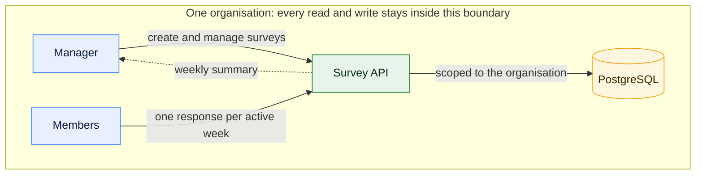

# Overview

Pulse Surveys is a small slice of a multi-tenant SaaS: organisations run short
weekly surveys, people answer them, and managers read a weekly summary. The build is a clean
vertical slice rather than a broad feature set.

## What it does

- An organisation owns pulse surveys. A survey has at most 3 questions.
- A question is either a rating from 1 to 5, or a yes/no choice.
- A Manager creates and manages surveys for their own organisation only.
- A Member submits one response per active week for a given survey.
- A summary endpoint reports, for a survey and a week: completion count, completion rate
  against the number of members in the organisation, and per-question rollups (average and
  count for ratings, a count per option for yes/no).
- A small React 19 app covers two flows: a Member answering the active survey, and a Manager
  reading the summary. It is a client-only single-page app: the browser renders everything and
  calls the API over HTTP, with no server components and no server rendering.

## How the pieces fit

The organisation boundary is the important line in the diagram: every read and write happens
inside one organisation, and nothing crosses.

## Rules that shape the design

| Rule | Where it lands |
| --- | --- |
| Each user belongs to exactly one organisation | Data model |
| Each user has exactly one role, Manager or Member | Data model and role checks |
| One organisation never reads or writes another's data | Every query and endpoint |
| At most 3 questions per survey | Validation at the API edge |
| One response per active week per survey | A database constraint, not only code |
| Answers match their question type | Validation at the API edge |

The organisation always comes from the authenticated user. It never comes from a request body
or a query string.

## Scope boundaries

Deliberately out of scope: no external identity provider, no paid cloud service, and no
production login flow, which is now a recorded decision rather than a gap
([ADR-0007](/adr/0007-no-production-sign-in.md)). Instead there is a credential-less dev sign-in: the app lists the seeded
users across both organisations and the visitor becomes whichever one they pick, until they log
out. A real server-side session keeps that choice: an opaque token in an httpOnly cookie, matched
to a row in the database, and the organisation is read from that row and from nowhere else. The
picker is a development-only affordance behind a flag, and the API fails closed when the flag is
off. See [ADR-0002](/adr/0002-dev-sign-in-with-server-side-sessions.md). The seed data carries at
least 2 organisations with a few Managers and Members each, so isolation is visible in the demo.

## Decisions

Settled:

- What "this week" means: an ISO 8601 calendar week in UTC, computed on the server and stored
  as a date on the response, in [ADR-0004](/adr/0004-calendar-week-in-utc.md).
- How tenant isolation is enforced: PostgreSQL row-level security, declared in Drizzle, with the
  API connecting as a separate non-owner role and the tenant context set per transaction, in
  [ADR-0005](/adr/0005-rls-with-a-non-owner-app-role.md).
- How surveys are created: a Manager-only API endpoint plus seeded surveys, so the rule that a
  Manager manages only their own organisation's surveys is demonstrated by the product and by
  its tests. The React app keeps the two flows the requirements name, and gains no create
  screen.
- How the current user and organisation are identified: a credential-less dev sign-in backed by
  a server-side session, in [ADR-0002](/adr/0002-dev-sign-in-with-server-side-sessions.md).
- How PostgreSQL runs locally: Docker Compose on `postgres:18.6`, in
  [ADR-0003](/adr/0003-local-postgres-with-docker-compose.md).
- How input is validated at the API edge: Zod 4 schemas run by Nest's
  `StandardSchemaValidationPipe`, in [ADR-0006](/adr/0006-zod-at-the-api-edge.md).
- That there is no production sign-in: the gated dev route is the only way to obtain a session, in
  [ADR-0007](/adr/0007-no-production-sign-in.md).

The design that follows from these is written as a spec in `okf/design/spec.md`, with the
contracts in `okf/pulse-surveys/`: the [Data model](/pulse-surveys/domain-model.md), the
[tenant isolation architecture](/pulse-surveys/architecture.md), the [API surface](/pulse-surveys/api.md)
and the [front end](/pulse-surveys/frontend.md).

## Reading paths

- The plan itself: [Spec: multi-tenant pulse surveys](/design/spec.md), with the contracts in
  [Data model](/pulse-surveys/domain-model.md), [Tenant isolation](/pulse-surveys/architecture.md),
  [API surface](/pulse-surveys/api.md) and [Front end](/pulse-surveys/frontend.md).
- Why the design is what it is: [Decision records](/adr/readme.md).
- The deliverable summary and the AI workflow: `SOLUTION.md` in the repository root.
